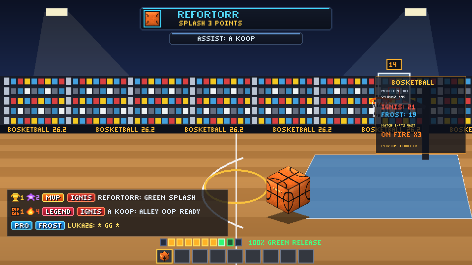
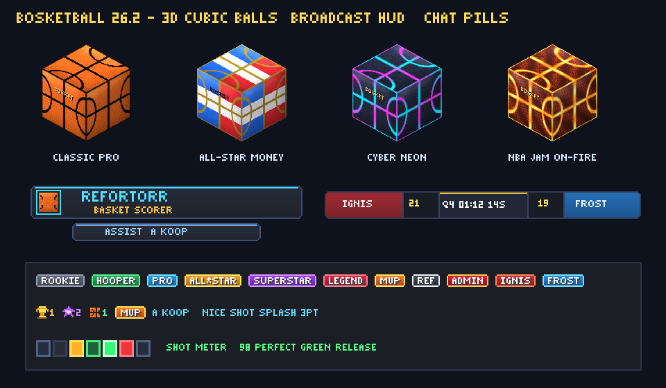

# ✦ ʙᴏꜱᴋᴇᴛʙᴀʟʟ 26.2 — ᴘʟᴜɢɪɴ & ʀᴇꜱᴏᴜʀᴄᴇ ᴘᴀᴄᴋ 3ᴅ ᴄᴏᴍᴘʟᴇᴛ ✦



**BosketBall 26.2** est une suite complète nouvelle génération de **Basket-Ball 3D compétitif** conçue pour **Minecraft Java Edition 26.2 ("Chaos Cubed")** et **100% rétro-compatible dès Paper / Purpur `1.21.10` jusqu'à `26.2`** (Java 21 à Java 25 • Pack Formats `65` à `88`).

Elle combine un **Plugin complet compilé en bytecode Java 21+** (compatible Paper `1.21.10` Adventure `4.25` et Paper `26.2` Adventure `5.2`) et un **Resource Pack 3D haute précision** (**Balle Carrée 3D sculptée en relief** dans l'esprit cubique *Chaos Cubed* 26.2, paniers en verre trempé animés, bannières BossBar Broadcast sans ombre portée via `ShadowColor.none()`, badges de rangs & classements en chat, typographie *small-caps* `ᴀ ʙ ᴄ ᴅ ᴇ ꜰ ɢ ʜ ɪ ᴊ ᴋ ʟ ᴍ ɴ ᴏ ᴘ ǫ ʀ ꜱ ᴛ ᴜ ᴠ ᴡ x ʏ ᴢ`, et 12 effets sonores `.ogg` Vorbis spatialisés).



---

## 📦 ʟɪᴠʀᴀʙʟᴇꜱ ᴘʀᴇᴛꜱ ᴀ ʟ'ᴇᴍᴘʟᴏɪ (`releases/`)

| Fichier | Description |
| :--- | :--- |
| **`releases/BosketBall-26.2.jar`** | Plugin universel **Paper / Purpur `1.21.10` → `26.2`** (`api-version: '1.21'`, bytecode Java 21+, validé sur Adventure `4.25` & `5.2`) |
| **`releases/BosketBall-ResourcePack-26.2.zip`** | Resource Pack universel **Minecraft `1.21.10` → `26.2`** (`min_format: 65, max_format: 88`, strict JSON) |
| **`releases/BosketBall-ResourcePack-26.2.zip.sha1`** | Empreinte SHA-1 exacte pour distribution automatique au join |
| **`resourcepack/blockbench/basketball_26_2.bbmodel`** | Fichier source **Blockbench** éditable de la **Balle Carrée 3D** sculptée en relief |

---

## 🏀 ꜰᴏɴᴄᴛɪᴏɴɴᴀʟɪᴛᴇꜱ ᴍᴀᴊᴇᴜʀᴇꜱ

### 1. Moteur Physique 3D 80Hz & Gameplay NBA
- **Physique 3D sous-échantillonnée à 80Hz (4 sous-pas/tick)** : gravité réaliste, traînée aérodynamique, rotation 3D `Quaternionf` (backspin sur les tirs, roulement au sol) et interpolation fluide `ItemDisplay` + hitbox `Interaction`.
- **Collisions Toriques 3D sur l'Anneau & Planche en Verre Trempé** : détection exacte sur tore d'acier (`R = 0.45m`, ratio NBA authentique `1.85:1`), tirs avec la planche (*Shooter's Square*), *rattle-in* dramatique et **Swish pur** freiné par le filet en nylon.
- **Jauge de Tir NBA 2K (Green Release)** : maintenez **Clic-Droit** pour charger la jauge en ActionBar (`\uE300`..`\uE306`) et relâchez dans la fenêtre verte pour un **100% Green Release** !
- **5 Styles de Slam Dunk 3D Aériens** : `⚡ Tomahawk Power`, `🌀 Windmill 360`, `💫 Hélicoptère 360°`, `🌙 Reverse Acrobatique` et `☄ Meteor Posterizer` (avec onde de choc repoussant les défenseurs sous le cercle !).
- **Passes Laser, Lobs Alley-Oop, Crossovers Ankle-Breaker, Interceptions & Contres Aériens** :
  - `Touche Q (Jeter)` ou `Slot 1` : Passe directe vers le coéquipier visé, ou **Lob Alley-Oop** en visant au-dessus du cercle (rattrapable en plein saut pour un dunk aérien !).
  - `Shift (Accroupir)` ou `Slot 2` : **Crossover éclair** changeant le ballon de main et brisant les chevilles (`Ankles Broken`) des défenseurs proches.
  - `Clic-Gauche` en défense : **Interception active** sur le porteur ou **Contre aérien (`Block`)** en sautant face à un tir montant (avec protection *Goaltending*).
- **Mode NBA Jam "ON FIRE 🔥"** : à partir de 3 paniers consécutifs sans encaisser, le ballon bascule automatiquement sur le modèle animé magma **`basketball_fire`** avec aura de flammes et fenêtre verte élargie.

### 2. Modes de Jeu & Architecte de Stade 1-Commande
- **Modes compétitifs & solo** : `Duel 1v1 (21 pts)`, `Street 2v2`, `Pro 3v3`, `Ligue 5v5`, **`Concours à 3 Points All-Star`** (5 racks × 5 ballons dont les *Money Balls* tricolores à 2 pts en 60s !) et **`Entraînement Libre & Dunk Lab`**.
- **Générateur de Stade Complet (`/bb arena build <id>`)** : construit instantanément un parquet bicolore NBA (`31×17`), lignes en quartz lisse, arcs à 3 points, raquettes peintes Ignis/Frost, table de marque LED, **tribunes mosaïques sur 4 niveaux**, **4 pylônes projecteurs** et **Jumbotron central 4 faces** + les **2 Paniers 3D animés** avec horloges des 24s !

### 3. UI Broadcast, BossBars Superposées, Rangs, TabList & Chat
- **Double BossBar Broadcast sans cadre vanilla** (`white_background.png` transparent + glyphes `ShadowColor.none()` à largeur verrouillée au pixel près) :
  - En jeu : **Scorebug Live 5 colonnes** (`IGNIS | 21 | Q4 01:12 14s | 19 | FROST`).
  - Après chaque panier : **Bannière Buteur** (`REFORTORR • ꜱᴘʟᴀꜱʜ 3 ᴘᴏɪɴᴛꜱ` / `ꜱʟᴀᴍ ᴅᴜɴᴋ`) + **Sous-Bannière Passeur** (`ᴀꜱꜱɪꜱᴛ: A_Koop`) juste en dessous !
- **Système de Rangs ELO & Badges Chat Dynamiques** :
  - 9 Rangs pixel-art (`ROOKIE`, `HOOPER`, `PRO`, `ALL-STAR`, `SUPERSTAR`, `LEGEND`, `MVP`, `ARBITRE`, `ADMIN`) + pilules d'équipe (`IGNIS`, `FROST`).
  - Badges automatiques du Top 3 serveur en direct devant le pseudo : **`[🏆1]` Victoires**, **`[⭐2]` ELO**, **`[🏀1]` Points**, **`[🔥4]` Série**, carte scouting interactive au survol et **Clic-pour-Défier en 1v1** !
- **TabList animée** avec logo pixel-art `\uE105` et **Sidebar sans chiffres rouges** (`NumberFormat.blank()`).

---

## ⚡ ɪɴꜱᴛᴀʟʟᴀᴛɪᴏɴ ʀᴀᴘɪᴅᴇ (ᴘᴀᴘᴇʀ 26.2)

1. Copiez **`releases/BosketBall-26.2.jar`** dans le dossier `plugins/` de votre serveur **Paper / Purpur 26.2** (Java 25).
2. *(Option A — Client / Solo / Test rapide)* Copiez **`releases/BosketBall-ResourcePack-26.2.zip`** dans `.minecraft/resourcepacks/` et activez-le.
3. *(Option B — Distribution automatique multi-joueurs)* Placez `BosketBall-ResourcePack-26.2.zip` dans `plugins/BosketBall/` et activez `resource-pack.embedded-http-server.enabled: true` (en renseignant l'IP publique dans `public-host`) ou renseignez `external-url` dans `plugins/BosketBall/config.yml`.
4. En jeu (avec OP ou `bosketball.admin`), exécutez :
   ```text
   /bb arena build centre Bosket Center
   /bb
   ```

---

## 🎮 ᴄᴏᴍᴍᴀɴᴅᴇꜱ & ᴘᴇʀᴍɪꜱꜱɪᴏɴꜱ

| Commande | Description | Permission |
| :--- | :--- | :--- |
| `/bb` ou `/bb menu` | Ouvrir le menu principal interactif 3D | `bosketball.play` |
| `/bb play [1v1\|2v2\|3v3\|5v5]` | Rejoindre ou lancer un match compétitif | `bosketball.play` |
| `/bb 3pt` | Lancer le Concours à 3 Points (5 racks, Money Balls) | `bosketball.play` |
| `/bb practice` | Entrer dans le terrain d'entraînement & Dunk Lab | `bosketball.play` |
| `/bb duel <joueur>` | Envoyer ou accepter un défi Duel 1v1 | `bosketball.play` |
| `/bb locker` | Ouvrir le Vestiaire 3D (4 Skins de ballons & 5 Dunks) | `bosketball.play` |
| `/bb stats [joueur]` | Afficher la carte de statistiques détaillées | `bosketball.play` |
| `/bb top` | Ouvrir le Panthéon des classements Top 10 | `bosketball.play` |
| `/bb pack` | Recevoir le Resource Pack 3D officiel 26.2 | `bosketball.play` |
| `/gg` | Message fair-play stylisé en fin de match (`+10 XP`) | `bosketball.play` |
| `/bb arena <build\|list\|tp\|delete>` | Construire et gérer les stades 3D | `bosketball.admin` |
| `/bb rank <set\|elo> <joueur> <val>` | Définir le rang ou l'ELO d'un joueur | `bosketball.admin` |
| `/bb giveball [classic\|money\|neon\|fire]` | Obtenir les objets 3D (Ballon, Trophée, Sifflet, Sneakers) | `bosketball.admin` |
| `/bb forcestart` / `/bb stop` / `/bb reload` | Contrôle de match et rechargement de la configuration | `bosketball.admin` |

---

## 🛠 ᴄᴏᴍᴘɪʟᴀᴛɪᴏɴ & ʀᴇɢᴇɴᴇʀᴀᴛɪᴏɴ ᴅᴇꜱ ᴀꜱꜱᴇᴛꜱ

- **Compiler avec Gradle (Java 25)** : `./gradlew build`
- **Compiler avec Maven (Java 25)** : `mvn clean package`
- **Régénérer tous les modèles 3D, textures PBR, glyphes & sons `.ogg` du Resource Pack 26.2** :
  ```bash
  python3 tools/generate_resourcepack.py
  ```
