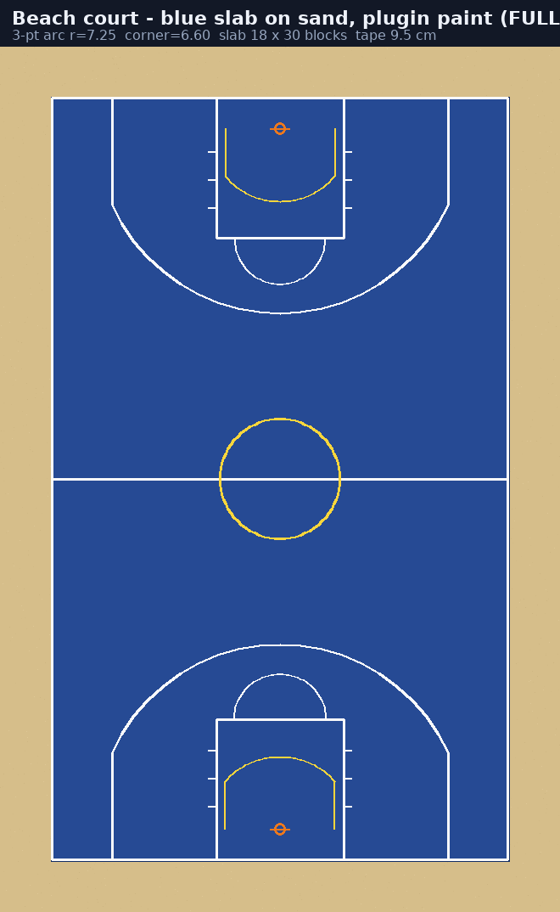
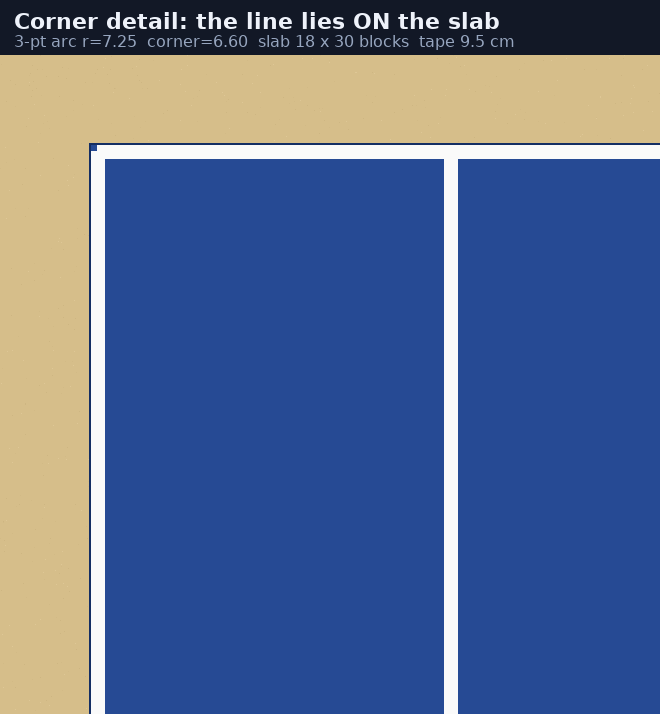

# Terrains instanciés : `terrain.schem` + `terrainsseize.schem` (50 arènes privées)

Chaque match 1v1 / 2v2 / 3v3 / 5v5 **et** chaque session solo (entraînement, concours à 3 points)
reçoit **sa propre copie** de ton terrain, collée dans un monde vide dédié, très loin du spawn.
Aucun terrain n'est jamais partagé entre deux joueurs.

> **Round 39** — le pool sert maintenant **deux** terrains : l'arène intérieure `terrain.schem` et
> le court extérieur `terrainsseize.schem`. Les deux tournent dans les 50 emplacements, chaque match
> prend une arène **libre au hasard**, donc il tombe sur l'un ou sur l'autre. Voir
> [Deux terrains, un tirage au sort](#deux-terrains-un-tirage-au-sort).

## Pourquoi ça ne marchait pas avant (corrigé)

Le plugin ne lisait que l'ancien format Sponge **v1** (`Palette` directement à la racine du fichier).
FastAsyncWorldEdit **2.11 et plus récent** — donc ton 2.16.1 — écrit du Sponge **v3**, où tout est
imbriqué dans `Blocks` → `Palette` + `Data`. Résultat : `Unsupported schematic (no Palette)`, le pool
restait à l'arrêt, et `/practice` te renvoyait sur l'ancienne arène générée.

Trois choses ont changé :

1. **Les trois formats sont lus** (v1, v2, v3 — et l'ancien `.schematic` MCEdit est détecté pour
   renvoyer un message clair). Plus besoin de convertir quoi que ce soit.
2. **Plus aucun repli sur l'ancienne arène.** Dès que `schematic-courts.enabled: true`, l'arène
   générée `main` et le monde `bosketball_practice` ne sont plus jamais distribués. Si `terrain.schem`
   n'est pas encore lisible, tu reçois un message explicite au lieu d'une vieille arène.
3. **Le monde `bosketball_practice` est supprimé** au démarrage (dossier compris) —
   `retire-legacy-practice-world: false` si tu veux le garder.

## Installation en 4 étapes

1. Ton build est terminé dans le monde de ton choix.
2. `//copy` — le plugin compense automatiquement l'origine « centrée » d'un copy au milieu.
3. `//schem save terrain` (FastAsyncWorldEdit), **ou** dépose le fichier ici :
   `plugins/BosketBall/schematics/terrain.schem`
   Le plugin cherche aussi tout seul dans `plugins/FastAsyncWorldEdit/schematics/`
   et `plugins/WorldEdit/schematics/` : tu n'as rien à déplacer si FAWE les a déjà sauvegardés là.
4. `/bb arena schematic reload` (ou redémarre le serveur).

## Ce que le plugin calcule tout seul

| Élément | Comment |
|---|---|
| Coins du terrain jouable | `half-width` / `half-length` ne font que **réduire** le rectangle auto-ajusté au build — jamais le dépasser |
| Centre exact du terrain | le point où tu te tenais au `//copy` (tag `Offset`), pas le coin du collage |
| `floorY` (sol sur lequel rebondit la balle) | la couche pleine la plus haute qui couvre ≥ 90 % de l'emprise (un mât, un panneau ou un toit ne la déplace plus) |
| Orientation des paniers | `hoop-facing: auto` = le **côté long** du build (un terrain est toujours plus long que large) ; `east-west` / `north-south` pour forcer |
| `origin-y` | c'est le **niveau du sol** (`64` par défaut) : le build est décalé pour que son plancher tombe pile dessus |
| Paniers 3D + shot clock | posés par le plugin (`rim-relative-y`, `rim-inset`), aucun modèle dans ton schematic — c'est ce que tu voulais |
| Lignes de terrain | déjà dans ton build → le plugin ne rajoute pas ses 80 BlockDisplays |
| Cage de collision (balle + joueurs) | ajustée au rectangle jouable |
| Hauteur du plafond de jeu | 16,5 blocs au-dessus du sol |

Rien de tout ça n'est « au hasard » : si un réglage est faux, `/bb arena schematic info` te donne les
valeurs réellement calculées, et tout se règle dans `config.yml` → `schematic-courts:`.

## Performance (le point important pour 25 joueurs en même temps)

- **Le fichier n'est lu qu'une fois.** `terrain.schem` est décodé en tableaux plats d'indices de
  palette (~4 octets par bloc). Coller une arène = un simple parcours de tableau, **aucune I/O,
  aucun parsing, aucune dépendance FAWE**.
- **Budget par tick.** Aucun tick n'écrit plus de `max-blocks-per-tick` blocs (40 000 par défaut,
  ≈ 1 ms). Une arène peut donc s'étaler sur plusieurs ticks sans jamais créer de lag spike.
- **Pré-chauffage.** Deux arènes propres sont maintenues prêtes en permanence : le joueur suivant
  ne paie pas le collage.
- **Nettoyage.** 30 s après la fin d'un match (`unpaste-delay-seconds`), l'arène est recollée à
  l'identique : un terrain modifié ne peut jamais être réutilisé tel quel.
- **Pool partagé.** 50 arènes pour 25 joueurs, avec priorité aux matchs : `busy` dans
  `/bb arena schematic info` te dit combien sont occupées.
- **Recherche automatique du fichier.** Le plugin fouille `plugins/BosketBall/schematics/`,
  `plugins/FastAsyncWorldEdit/schematics/`, `plugins/WorldEdit/schematics/` **et leurs
  sous-dossiers** : un `//schem save terrain` suffit, rien à déplacer.
- **Rechargement automatique.** Si le fichier apparaît (ou devient lisible) plus tard, le pool se
  lance tout seul dans les 10 secondes — plus besoin de redémarrer.

## Vérifier en jeu

```
/bb arena schematic info
```
Tu dois voir une ligne `Terrain:` par fichier du pool (`terrain` et `terrainsseize`), avec sa
taille, sa version Sponge, son nombre de panneaux, son nombre de têtes et **combien d'arènes
utilisent ce terrain**, puis la position du terrain #1, l'axe des paniers et la taille du rectangle
jouable. Si quelque chose cloche, c'est ici que ça se voit avant de lancer un match.

## Commandes

```
/bb arena schematic info        état du pool, taille du schematic, floorY calculé, axes
/bb arena schematic reload      relit le .schem et réaligne les 50 arènes
/bb arena schematic repaste     recolle toutes les arènes libres
/bb arena schematic goto <n>    se téléporter sur l'arène n° n (calibrage)
```

## Réglages utiles (`config.yml`)

```yaml
schematic-courts:
  instances: 50            # nombre d'arènes privées
  spacing-blocks: 384      # écart MINIMUM entre deux arènes (le pool l'élargit si besoin)
  origin-x: 100000         # premier terrain, très loin du spawn
  origin-z: 100000
  world-name: bosketball_courts
  floor-relative-y: 0      # +1 pour monter la physique d'un bloc si le sol paraît enterré
  rim-relative-y: 3        # hauteur du cerceau au-dessus du sol (3 = 3.05 m)
  rim-inset: 1.25          # distance du cerceau à la ligne de fond
  hoop-facing: auto        # auto | north-south | east-west
  max-blocks-per-tick: 40000
```

Si tu changes la taille/forme du build : `//schem save terrain` puis
`/bb arena schematic reload`. Aucun redémarrage n'est nécessaire.

### Aucune arène ne peut en chevaucher une autre (Round 41)

L'écran du propriétaire montrait l'arène indoor et l'arène cyan **fusionnées** : l'écart venait
directement de `spacing-blocks`, et rien ne le comparait à la taille des builds. Un 64 (la valeur
minimale acceptée) posait le terrain de 101 blocs de long sur son voisin.

Trois garde-fous, dans cet ordre :

1. `spacing-blocks` est un **minimum**. Le pool calcule l'écart réel :
   `max(config, plusGrandBuild + 32)` et écrit une ligne `[Courts] spacing-blocks (64) is smaller
   than the largest build (101 blocks) — using 133 …` quand il corrige ;
2. la grille est construite avec cet écart (`gridColumns = ceil(sqrt(instances))`) ;
3. **audit** : chaque emprise (X/Z du build collé) est comparée à toutes les précédentes ; une arène
   qui toucherait une autre est **ignorée** (`Court #n would overlap … — skipped`) et compte dans la
   ligne finale `N instance(s) laid out …, X skipped to avoid an overlap.`

Les trois fonctions (`requiredSpacing`, `effectiveSpacing`, `footprintsOverlap`) sont pures et
testées : `round41CourtsNeverOverlapWhateverTheConfigSays` rejoue les 50 arènes avec 64, 96, 128 et
384 blocs d'écart et vérifie qu'aucune paire ne partage une colonne de blocs.

> **Après une mise à jour de l'écart**, les anciennes arènes restent collées dans le monde
> `bosketball_courts`. Serveur arrêté, supprime le dossier `bosketball_courts/` : il sera recréé et
> les 50 arènes recollées aux bonnes positions au démarrage suivant.

### Une chance sur deux entre les terrains (Round 41)

Le choix du terrain ne dépend plus de « la première arène libre ». À chaque match :

```java
int wanted = pickTerrain(variants.size(), random);          // pile ou face uniforme
Slot picked = pickFreeOfTerrain(free, slot -> slot.variant, wanted, random);
```

Donc avec deux builds dans `schematics:`, **un match sur deux** tombe sur chacun, et les arènes du
terrain tiré sont réparties au hasard. Si ce terrain n'a plus d'arène libre, le match prend une
arène de l'autre terrain plutôt que d'être refusé. Testé :
`round41TerrainIsARealOneInTwoCoinFlip` (4 000 tirages, 45–55 % chacun).

```yaml
schematic-courts:
  schematic: terrain.schem        # forme historique : le PREMIER terrain du pool
  schematics:                     # le pool (round 39) : une entrée par build
    - terrain.schem
    - terrainsseize.schem
```

Le pool alterne les fichiers : arène n°1 = `terrain.schem`, n°2 = `terrainsseize.schem`, n°3 =
`terrain.schem`… Comme le match prend une arène libre **au hasard**, la pioche est bien aléatoire
d'une partie à l'autre. Un fichier illisible est sauté (ligne claire dans la console) : les autres
terrains continuent de tourner. Les deux `.schem` livrés sont dans le jar et sont extraits
automatiquement au premier lancement.

## Ce que les tests couvrent

La suite JUnit (60 tests) écrit un **vrai fichier `.schem` gzippé au format FAWE** puis le décode
avec le lecteur de production, et vérifie : dimensions, offsets d'un copy centré, détection du sol,
palette, comptage des blocs pleins, rejet propre d'un fichier corrompu (message d'erreur explicite),
valeurs par défaut de la config, et absence de chevauchement des 50 emplacements.

### Deux réglages qui existaient sans être documentés

`BosketConfig` lisait `schematic-courts.rim-material` et `schematic-courts.floor-relative-y` depuis
le début, mais le `config.yml` livré ne les contenait pas : impossible de les découvrir sans lire
le code. Ils sont maintenant présents, commentés, avec leurs valeurs par défaut exactes
(`OCHRE_FROGLIGHT` et `0`).

---

# Round 39 — le court extérieur `terrainsseize.schem`

## Deux terrains, un tirage au sort

`schematic-courts.schematics` liste les builds du pool. Le plugin les décode **une fois chacun** et
garde leurs tableaux d'indices en mémoire (~0,8 Mo par terrain, aucune I/O au collage) ; chaque
emplacement du pool retient **son** terrain, avec **sa** calibration.

| | `terrain.schem` | `terrainsseize.schem` |
|---|---|---|
| Taille du build | 49 × 21 × 52 | **75 × 26 × 101** |
| Format | Sponge v3 (FAWE 2.16.1) | **Sponge v2** (Axiom 6.1.3) |
| Blocs pleins | 18 246 | 18 029 |
| Terrain coloré détecté | orange, **27 × 15** | cyan, **25 × 31** |
| Axe des paniers | est-ouest (X) | **nord-sud (Z)** |
| Centre / origine du collage | 25,5 / 25,5 | **37,5 / 50,5** = pile le milieu du build |
| Rectangle jouable (après `half-width`/`half-length`) | 15 × 27 | **18 × 30** |
| Panneaux | 216 | 4 |
| Têtes custom | 0 | **2** |
| Lignes | dessinées par le plugin | dessinées par le plugin (le sol est peint en cyan, sans peinture blanche) |

### Ce que dit le schematic, et ce que le plugin en fait

Analyse bloc par bloc du fichier (couche par couche) :

* **le sol** : `sand` sur toute l'emprise en y=0, puis le **tracé peint en cyan en y=1** —
  `cyan_wool` (157 blocs, x 25..49, z 35..65) et `cyan_concrete_powder` (310 blocs, x 25..49,
  z 38..62). C'est la seule grande surface colorée du build, donc `detectCourt()` la trouve tout
  seul : boîte **25 × 31**, centre **37,5 / 50,5** ;
* **la bordure du tracé** : `warped_nylium` + `stripped_warped_stem` + `pale_oak_stairs`
  waterlogged de z 31 à 69 — elle dessine le pourtour extérieur (25 × 39) et sert de crédible
  « ligne de fond » visuelle. Le cercle de milieu de terrain est visible en laine cyan autour de
  z 48..52 ;
* **les paniers** : le build n'en contient aucun (comme pour l'arène intérieure, c'est le plugin
  qui les pose). L'axe est lu sur le terrain coloré : 31 > 25 → **nord-sud**. Avec
  `half-length: 15`, les cerceaux tombent à **z = 50,5 ± 13,75** (donc 36,75 et 64,25), à
  `origin-y + 3` (3,05 m), **à l'intérieur** du tracé peint ;
* **les lignes** : le sol cyan n'a aucune peinture blanche → `flush-floor` ne trouve rien et le
  plugin dessine ses lignes à plat dans le rectangle 18 × 30, donc entre les bandes cyan ;
* **la hauteur** : le point le plus haut du build est à y=15 (les `big_dripleaf`), aucun plafond
  n'est détecté → la cage de collision monte à 16,5 blocs au-dessus du sol ;
* **les décors** : 156 `short_dry_grass`, 149 `tall_dry_grass`, 146 `dead_bush`,
  80 `big_dripleaf`, 13 `short_grass`, 7 `firefly_bush`, 9 `carrots`, 7 `azalea`, 12 boutons
  `pale_oak`, 8 leviers, 2 échafaudages, des murets `granite` / `brick` / `blackstone` /
  `mud_brick` — tout ça est conservé.

### Les 4 panneaux

| Position | Bloc | Contenu |
|---|---|---|
| `[37, 2, 30]` | `birch_sign[rotation=0]` | `ᴄʀᴇᴅɪᴛ` / `@sseize` / `=-------------=` — light_blue, texte brillant |
| `[37, 2, 70]` | `birch_sign[rotation=8]` | idem |
| `[58, 2, 52]` | `bamboo_wall_sign[facing=east]` | vide |
| `[59, 2, 49]` | `bamboo_wall_sign[facing=east]` | vide |

Les deux panneaux de crédit sont **exactement derrière chaque ligne de fond**, dans l'axe du
terrain (x = 37 = centre) : ce sont eux qui ont servi de repère pour vérifier que l'axe
nord-sud et le centre 37,5 / 50,5 étaient les bons.

### Les 2 têtes custom

| Position | Bloc | Profil |
|---|---|---|
| `[57, 3, 50]` | `player_head[powered=true, rotation=11]` | `maxlananas` |
| `[56, 3, 54]` | `player_head[powered=false, rotation=14]` | `friandise` |

Elles sont sur les murets/échafaudages à côté du terrain (x 56-57). Le collage écrit **le bloc**
(rotation + powered) puis ré-applique **la peau** : voir
[`court-orientation-and-sign-protection.md`](court-orientation-and-sign-protection.md#6-têtes-custom-le-bloc-et-la-peau).

#### Round 42 — pourquoi une des deux têtes restait en Steve

Le `.schem` ne contient **que le pseudo** dans la charge utile de la tête (`profile.name`), sans
propriété `textures` ni UUID. La peau dépend donc entièrement de la résolution côté serveur, et le
résolveur s'arrêtait à ce que la machine connaissait déjà :

| Étape | Avant R42 | Après R42 |
|---|---|---|
| `profile.properties.textures` du `.schem` | essayé | essayé |
| `schematic-courts.head-skins` (config) | — | **prioritaire** |
| cache local (`usercache`, `completeFromCache`) | essayé | essayé |
| profils en mémoire du serveur | essayé | essayé |
| `PlayerProfile#complete()` (session server, hors thread principal) | **jamais** | **essayé** |

D'où le symptôme : `maxlananas` est un compte que le serveur connaît → peau correcte ;
`friandise` n'a jamais rejoint le serveur et n'était pas dans le cache → aucune texture → Steve.
Trois corrections :

1. la passe asynchrone appelle `profile.complete()` avant de conclure — toujours **hors du thread
   principal** (c'est un appel web), et le watchdog de 30 s réessaie les têtes déjà collées ;
2. l'UUID de repli est l'UUID « offline player » du pseudo, plus un UUID aléatoire : le client
   réutilise la peau qu'il a déjà téléchargée au lieu de la redemander à chaque collage ;
3. `schematic-courts.head-skins` permet d'**épingler** la peau si le compte a été renommé ou
   supprimé (auquel cas plus rien ne peut la retrouver) :

```yaml
schematic-courts:
  head-skins:
    friandise: "eyJ0ZXh0dXJlcyI6...;abc123..."   # valeur de la propriété textures, signature
    # la signature est facultative : "eyJ0ZXh0dXJlcyI6..." suffit
```

La valeur se lit dans n'importe quel outil de profil Minecraft (« textures value ») ; une valeur
épinglée gagne sur toutes les autres sources. Après modification : `/bb reload`, puis
`/bb arena repaste` (ou supprimer `bosketball_courts/` et redémarrer) pour re-coller les têtes.

## Le collage est blindé

« Aucun bloc illégal ne casse » est maintenant vrai à quatre niveaux :

1. **Palette résolue en cascade** — chaque entrée est essayée telle quelle, puis **propriété par
   propriété** (on retire celle que le serveur ne connaît plus, on garde les autres : orientation,
   waterlogged, moitié de marche…), puis en **matériau nu**, et enfin en **air**. Jamais de
   `IllegalArgumentException` qui remonte, et surtout **plus de repli en pierre** : un bloc
   inconnu laissait un mur de pierre au milieu du terrain, il laisse maintenant un trou invisible
   et **une ligne de log avec son nom exact**. `paletteNotes()`, `droppedPaletteEntries()` et
   `repairedPaletteEntries()` exposent le résultat.
2. **Écriture gardée bloc par bloc** — chaque `setBlockData` est dans un `try/catch` : un bloc que
   le serveur refuse coûte **un** bloc (`writeFailures()`), jamais le terrain entier.
3. **Décor posé après son support** — les attaches habituelles (panneaux, torches, leviers,
   trappes, barrières…) *et* désormais **toute la flore** (`_grass`, `_bush`, `_dripleaf`,
   `carrots`, `azalea`) passent dans le **second passage**, une fois la structure en place : une
   touffe d'herbe sèche posée sur du sable ne peut plus « pop » pendant le collage.
4. **Réparation avec abandon** — le passage de réparation remet en place tout ce qui a disparu,
   mais compte les échecs : un décor que le serveur refuse physiquement deux fois de suite (une
   feuille de dripleaf sans tige, par exemple) est **abandonné** au lieu d'être recollé chaque
   seconde (`abandonedDecorations()`). Et juste après le collage, les items tombés au sol sont
   balayés.

## Ce que les tests couvrent (round 39)

| Test | Vérifie |
|---|---|
| `bundledStreetCourtIsTheSecondTerrainOfThePool` | 75×26×101, Sponge v2, palette 85, 18 029 blocs, sol local Y1, terrain cyan 25×31, centre 37,5/50,5, axe nord-sud, 308 blocs peints |
| `streetCourtKeepsItsSignsAndItsCustomHeads` | 4 panneaux et 2 têtes conservés **avec leur charge utile lue à plat** (texte `@sseize`, light_blue, brillant, noms `friandise` / `maxlananas`) |
| `flatSpongeV2PayloadsSurviveTheLoad` | un `.schem` v2 écrit par le test : texte du panneau, valeur et signature de texture de la tête |
| `everyBlockOfBothTerrainsExistsOnThisServer` | les 85 entrées des deux fichiers existent dans `Material` |
| `anIllegalBlockCanNeverAbortACourtPaste` | ordre des candidats de résolution (exact → propriété retirée → matériau nu) |
| `theTwoTerrainsAlternateThroughThePool` | alternance des terrains sur les 50 emplacements |
| `theConfigListsBothTerrains` | `schematics:` + compatibilité de la clé historique `schematic:` |

# Round 43 — le terrain de plage (dalle de sable + lignes du plugin)

Un terrain de plage est un **deck de sable** : le build n'apporte pas de sol coloré, c'est le
plugin qui pose la dalle bleue et qui peint les lignes. Ce cas se vérifie sans client, parce que
tout ce qu'on y voit est calculé par le plugin.

## Ce que le plugin détecte dans un deck de sable

* `sand`, `red_sand`, `gravel`, `dirt_path`, `grass_block`… sont des **surfaces neutres** : elles
  peuvent être le terrain, mais elles ne passent jamais devant un sol peint. Un deck de sable sous
  un terrain bleu en béton ne gagne donc jamais.
* Le **ruban blanc** posé dans le sable n'est pas un terrain peint : `white`, `quartz`,
  `smooth_stone`, `polished_diorite` et `snow` sont lus comme de la **bande** (`isTapeFamily`).
  Avant, la moindre bande blanche faisait exister un « terrain peint », ce qui disqualifiait le
  sable : plus aucun rectangle n'était trouvé et les lignes partaient au milieu du fichier.
  Désormais le sable à l'intérieur de sa propre bande est le deck, et les lignes sont ajustées
  dessus.
* Un vrai terrain peint (béton, laine, terre cuite…) reste prioritaire : 25×31 cyan sur une rue de
  sable de 75×101 reste le 25×31.

## La géométrie de la peinture

`CourtPaint` est de la géométrie pure (aucune entité, aucun monde) : c'est une liste de segments
`(x0,z0)-(x1,z1)` avec une largeur et une altitude, et `Arena` ne fait que les transformer en
`BlockDisplay`. Tout ce qui suit est donc mesurable dans les tests :

| Point | Valeur |
|---|---|
| Altitude des lignes | `floorY + 0.0045` (la dalle est à `+0.0015`, épaisseur 0.0015) |
| Bande de périmètre | largeur 0.095, **bord extérieur = bord de la dalle** : plus un demi-ruban qui pend sur le sable |
| Ligne de milieu | d'une ligne de touche à l'autre, dans le même plan |
| Cercle central | rayon 2.35, 18 segments, jaune |
| Raquette | largeur 5.0 max, profondeur 5.5 max, liseré jaune de la zone restrictive |
| Arc à 3 points | rayon 7.25, coin à 6.60, mesurés **sur l'axe des paniers** |
| Zone restrictive | rayon 2.85, épaule 2.15 — exactement les nombres du test de dunk |

L'axe des paniers compte. Les trois nombres de l'arc se lisent désormais sur cet axe et non sur X
et Z :

* le rayon est borné par la **distance du cercle au centre** (`rimDistanceAlongHoopAxis()`) — l'arc
  ne traverse jamais la ligne médiane — et par la place restée entre le coin et la ligne de touche ;
* le coin (6.60) est borné par la même place latérale, et par `rayon × 0.95` pour rester **dans**
  son propre arc ;
* la largeur et la longueur du rectangle ne sont plus interverties. Sur un deck dont les lignes de
  fond regardent l'est et l'ouest (le cas normal d'un terrain de plage 30 × 18), l'ancien calcul
  donnait un rayon de 6.12 avec un coin à 6.60, soit un coin plus loin que son arc : la ligne à
  3 points se repliait en calotte autour de la raquette.

Les deux terrains livrés ne bougent pas : l'arène intérieure (`terrain.schem`, rectangle 18 × 30,
cercles à 7.75 du centre) et le court cyan (`terrainsseize.schem`, rectangle 18 × 30, cercles à
13.75) gardent tous les deux un arc de 7.25 et un coin de 6.60.

Vue de dessus du tracé calculé par `CourtPaint` pour un deck de plage (rectangle jouable 18 × 30,
arc 7.25, coin 6.60), et détail du coin de fond : la bande est entièrement sur la dalle bleue.





## Ce que le plugin écrit dans la console

```
[Courts] Court lines (terrain.schem): drawn by the plugin (108 line block(s) found on the deck)
[Courts] Court size (terrain.schem): slab 30.0x18.0 inside a 32x20 sand/plain deck (108 tape block(s))
```

Si la bande du build tombe **en dehors** de la dalle, la console le dit et donne les deux sorties :

```
[Courts] Court size (monde.schem): the build's own tape lies outside the slab, so you will see it
around the painted court. Raise schematic-courts half-width (9.0 -> 11.0) and half-length (15.0 -> 17.0)
to cover it, or set court-floor.enabled: false to keep the build's paint only.
```

## Ce que les tests couvrent (round 43)

| Test | Vérifie |
|---|---|
| `aSandDeckIsFoundAsTheCourtRectangle` | fichier `.schem` de test : deck 34×22, rectangle trouvé, `painted = false`, sol local Y1 |
| `aPaintedDeckStillGetsThePluginsFloorAndLines` | sable + bande blanche : le rectangle reste trouvé (32×20 intérieur), le plugin peint quand même |
| `thePaintOfASandDeckFitsItsSlab` | la peinture ajustée au deck tient entièrement sur la dalle, arc à 7.25, coin à 6.60 |
| `noTapeEverLeavesTheBlueSlab` | 7 tailles de deck × 2 orientations × 3 presets : aucun segment ne dépasse la dalle |
| `theThreePointLineClosesOnItsOwnRadius` | le segment de coin et l'arc se rejoignent sur un seul point, chaque point de l'arc est à un rayon du cercle |
| `aDeckSavedSidewaysGetsTheRealThreePointLine` | deck est-ouest : même arc et même coin qu'un deck nord-sud |
| `theKeyAndTheRestrictedAreaStayInsideThePaint` | raquette ≤ 5 blocs de large, zone restrictive aux dimensions du test de dunk |
| `theBoundaryLineIsDrawnOnThePlayableEdge` | le bord extérieur du ruban **est** le bord jouable, et la ligne de milieu va d'une touche à l'autre |
