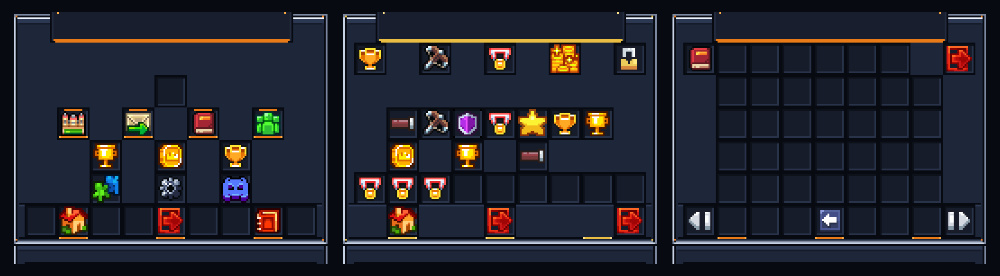

# Saison classée + refonte des GUI (v4)

> Livré le 4 novembre 2026. Tout est sur la branche `arena/a1145fcf-bosketball`.
> Build de référence : **224 classes, 0 erreur · 88 tests OK · pack 3 524 552 B (SHA-1 `48dc5ac1…`) · jar 4 413 393 B**.



---

## 1. La saison classée

### Ce qui existait
`general.season-name: "ꜱᴇᴀꜱᴏɴ ɪ"` : une **chaîne de caractères** affichée dans la tab list. Aucun reset,
aucune récompense, aucune archive. Le ladder ELO ne redescendait jamais : un joueur arrivé au top n'avait
plus rien à faire.

### Ce qui tourne maintenant

| Brique | Comportement |
|---|---|
| **Cycle** | Saison de `season.duration-days` jours (60 par défaut), démarrée automatiquement au premier boot, close automatiquement à l'échéance (vérifiée toutes les 60 s), et résolue au boot si elle a expiré hors-ligne |
| **Placements** | Les `season.placement-matches` premières parties classées (5) amplifient le gain/perte d'ELO de **×2,0 → ×1,0** linéairement. Le rang reste *provisoire* et s'affiche `PLACEMENT 2/5` dans la tab list, la sidebar et le menu |
| **Paliers** | Rookie → MVP (les 7 rangs existants). Chaque palier a un payout coins + XP configurable, croissant |
| **Soft reset** | À la clôture : `nouveau = ancre + (elo − ancre) × keep-ratio` (défaut `1200` / `0,5`), borné 100–99 999. La moitié de la progression survit, le reste se rejoue |
| **Récompenses** | Payées **automatiquement** à la clôture, y compris aux joueurs hors-ligne (file `pending`, réclamée à la reconnexion ou via `/season claim`) |
| **Podium** | Top 1/2/3 : bonus coins supplémentaire + **trophée permanent** compté sur le profil saisonnier |
| **Archive** | `plugins/BosketBall/seasons/archive/season-XX.yml` : dates, participants, top 10, ratio de reset, raison de la clôture |
| **Annonce** | Carte de chat + titre in-game + son de foule à la clôture, et un embed Discord si le webhook est actif |

### Fichiers ajoutés

```
src/main/java/fr/bosketball/season/
  SeasonMath.java      — formules pures (soft reset, swing de placement, paliers, romains) → testables sans Bukkit
  SeasonRecord.java    — état d'un joueur sur la saison courante
  SeasonResult.java    — ce qu'un match vient de changer (placement, nouveau record, palier)
  SeasonStanding.java  — une ligne de classement (uuid, nom, peak, tier, provisoire)
  SeasonState.java     — index, nom, début, fin, temps restant, avancement
  SeasonService.java   — cycle de vie, persistance atomique, rollover, récompenses, archives, broadcast
```

Persistance : `plugins/BosketBall/seasons/current.yml` (état + joueurs + récompenses en attente + trophées),
écrit de façon atomique, sauvegarde asynchrone toutes les 5 minutes et synchrone à la clôture/au shutdown.

### Commandes

| Commande | Effet |
|---|---|
| `/season` | Ouvre le hub Saison |
| `/season top` | Ouvre le hub sur le classement |
| `/season claim` | Réclame une récompense en attente |
| `/season end [confirm]` | *Staff* — clôture immédiate (paie tout, archive, reset) |
| `/season start [index]` | *Staff* — démarre une nouvelle saison |
| `/season days <1-365>` | *Staff* — recale la date de fin |
| `/bb season …` | Même routage (alias) |

### Configuration

Section `season:` ajoutée à `config.yml` (commentée, auto-ajoutée aux configs existantes par `loadAndUpgrade`) :
`enabled`, `duration-days`, `placement-matches`, `soft-reset.anchor`, `soft-reset.keep-ratio`,
`rewards.tier-coins[7]`, `rewards.tier-xp[7]`, `rewards.top-1/2/3-coins`.

### Intégrations

- **MatchSession** : le swing de placement est appliqué *avant* `adjustElo`, le résultat saisonnier est
  enregistré par joueur, et une carte « Season » est envoyée en fin de match (peak, bilan, placements).
  La fin des placements déclenche un titre + sifflet.
- **Tab list** : le pied affiche `SEASON II · 12d 4h` et remplace l'ELO par `PLACEMENT 3/5` tant que le
  joueur n'est pas placé. Le cache de rendu inclut le libellé de saison (donc le compte à rebours rafraîchit).
- **Sidebar** : la ligne « playtime » (la moins utile) est remplacée par la saison : palier + temps restant,
  ou placements en cours.
- **Connexion** : une récompense en attente est payée et annoncée à l'arrivée.

### Correctif au passage

Le pied de la tab list utilisait `"\\n"` dans des chaînes MiniMessage : MiniMessage n'interprète pas `\n`,
donc le séparateur s'affichait **littéralement** dans le jeu. Les rendus passent désormais par
`parseMultiline(...)` qui découpe et joint avec `Component.newline()`.

---

## 2. La refonte des GUI

### Diagnostic

Trois causes cumulées expliquaient le « bordel » :

1. **Deux systèmes graphiques superposés.** Le fond d'un coffre vient de
   `assets/minecraft/textures/gui/container/generic_54.png` (grille grise façon vanilla), et
   l'habillage vient d'un glyphe de 176×137 dessiné par le titre. Les deux ne se parlaient pas :
   tout ce que le glyphe laissait transparent montrait l'autre design.
2. **Des ornements partout.** Le kit v3 posait auvent, boulons, projecteurs, pellicule, pochettes…
   dans les gouttières de 2 px, parfois à côté de cases vides : à l'écran, ça se lit comme des slots cassés.
3. **Pas de hiérarchie de navigation.** 26 menus, des entrées dispersées (le lobby posait 12 icônes
   sur 4 lignes sans logique de groupe), et aucun chemin de retour commun.

### Ce qui a changé

#### a) Une grammaire de navigation unique — `GuiChrome`

`src/main/java/fr/bosketball/ui/kit/GuiChrome.java` fige le contrat des slots :

| Slot | Rôle |
|---|---|
| `0..8` | en-tête de contexte (onglets) |
| `45` / `53` | pagination précédent / suivant |
| `46` | **retour au lobby** (présent sur tous les menus 54 slots |
| `49` | retour au menu parent |
| `52` | **raccourci Saison** (présent sur tous les menus 54 slots) |

`applyStandardRail(...)` remplit ces slots **uniquement s'ils sont vides**, donc aucun menu n'est
écrasé : les 17 points d'ouverture de `GuiMenuManager` l'appellent automatiquement.

#### b) Le lobby à quatre portes

Le hub ne propose plus douze icônes en vrac, mais **quatre portes** alignées, une carte de profil et
trois raccourcis secondaires :

```
                      [ profil ]
   [ PLAY ]   [ SEASON ]   [ COLLECTION ]   [ SOCIAL ]
      [ Leaderboards ]  [ Historique ]  [ Progression ]
      [ Practice ]      [ Réglages ]   [ Discord ]
   [ leave ] [ lobby ]         [ back ]         [ saison ] [ guide ]
```

Chaque porte répond à un clic gauche / droit / shift documenté dans la lore, donc les sous-menus ne
sont plus cachés dans un item au hasard.

#### c) Court Console v4 — le kit graphique réécrit

`tools/bosket_gui_kit.py` est réécrit autour de **quatre règles** :

1. **Un seul cadre** : contour encre 1 px, biseau clair en haut/gauche, biseau sombre en bas/droite.
2. **Une seule grille** : les 54 puits sont dessinés identiquement, au pitch client exact (18 px).
3. **Un seul accent par menu**, utilisé à trois endroits : soulignement du panneau de titre, accents de
   puits « bouton », chips de la barre de navigation.
4. **Rien ne traverse un puits** : tout ornement vit dans les gouttières ou sur le cadre — vérifié par
   assertion à la génération (`_assert_grid_clean`).

Deux garanties ont été ajoutées pour empêcher la régression qui a produit le rendu « cassé » :

- `assert_opaque_cover(img)` : chaque pixel d'un overlay de conteneur doit être **opaque**, sinon
  l'ancienne texture de coffre repasse au travers ;
- `generate_container_textures(...)` : recolorise `generic_54/hopper/dispenser/shulker/inventory` dans
  la palette v4 et **repeint la moitié « inventaire joueur »** avec le même cadre, la même grille et la
  même palette — l'écran ne mélange plus deux designs.

Le test JUnit qui verrouillait l'ancienne palette (« titre sur plaque claire », « cadre argent brossé »)
a été réécrit sur le contrat v4 : cadre navy (b > g ≥ r), biseau clair à gauche, puits sombres, moitié
inventaire identique.

#### d) Un menu Saison complet

Nouvel overlay `U+E34C` (`gui_overlay_season.png`) + `MenuType.SEASON` :

- bandeau haut : nom de la saison, compte à rebours, barre de progression du cycle, palier courant,
  paiement projeté, récompense en attente ;
- piste des 7 paliers avec plage d'ELO, payout et marqueur « vous êtes ici » (enchantment glint) ;
- bilan de saison (matchs, W-L, win rate) ;
- top 9 avec têtes de joueurs cliquables ;
- rail standard : retour, lobby, fermeture.

---

## 3. Vérifications

- `python3 tools/build_plugin.py` → `✓ 224 classes, 0 errors`, `OK (88 tests)`, jar reproductible.
- Nouveaux tests : formules de soft reset / swing de placement / bornes, romains, progression,
  défauts de config (7 paliers croissants, podium > tier), présence des clés `season:` dans `config.yml`,
  `/season` + alias dans `plugin.yml`, avance de glyphe 177 px et hauteur 137 px de l'overlay saison,
  et vérification que le hub expose bien les quatre portes.
- La génération du pack échoue désormais si un overlay contient un pixel transparent ou un ornement
  dans une gouttière.

---

## 4. Ce qui reste à faire (honnêtement)

1. **`GuildGuis` et `ProgressionGuis`** gardent leurs layouts internes ; elles n'ont pas encore le rail
   `home/saison`. C'est le prochain lot mécanique.
2. **Battle pass saisonnier** (50 paliers, piste gratuite/premium) : la saison fournit maintenant la
   colonne vertébrale, le pass s'y branche.
3. **Anti-triche** : le ladder saisonnier n'a de valeur que si l'ELO est crédible.
4. **Tournois** : brackets + overlay spectateur, en réutilisant `SeasonStanding` pour le seeding.
5. **Bedrock/Geyser** : les overlays v4 sont des glyphes de police, donc à re-décliner côté Bedrock.
